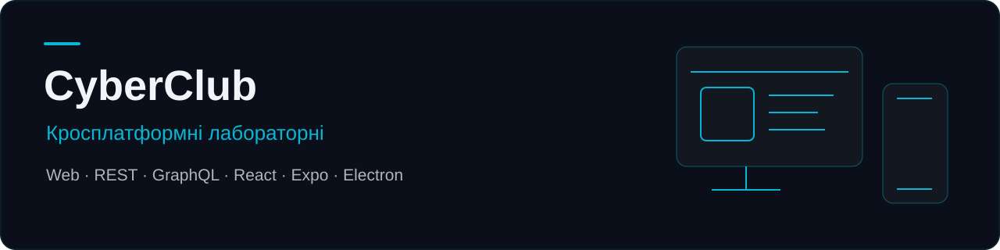

# CyberClub

Лабораторні роботи з дисципліни «Крос-платформне програмування»: одна предметна область бронювання місць у комп'ютерному клубі, реалізована як вебсторінка, API, React SPA, мобільний та десктопний застосунки. Кожна лабораторна — окремий навчальний проєкт.

## Лабораторні та вихідний код

| Робота                             | Реалізація                                                  | Стек і збереження даних                              |
| ---------------------------------- | ----------------------------------------------------------- | ---------------------------------------------------- |
| [1 — Вебзастосунок](lab-1/)        | Адаптивне бронювання та історія сесій                       | HTML, CSS, JavaScript, localStorage                  |
| [2 — REST API](lab-2/)             | CRUD бронювань, DTO-валідація, журнал запитів               | NestJS, TypeScript, MongoDB, Mongoose                |
| [3 — GraphQL API](lab-3/)          | Реєстрація, вхід, запити й мутації бронювань                | NestJS, Apollo Server, JWT, bcryptjs; дані в пам'яті |
| [4 — React SPA](lab-4/)            | Форма, тарифи, стани, пошук і фільтри                       | React, Vite, TypeScript, Tailwind CSS; localStorage  |
| [5 — Мобільний застосунок](lab-5/) | Створення, перегляд, пошук і зміна стану бронювань          | React Native, Expo, TypeScript; дані в пам'яті       |
| [6 — CyberClub Desktop](lab-6/)    | Бронювання у вікні desktop-застосунку, збереження через IPC | Electron, JavaScript, HTML, CSS; локальний JSON-файл |

React, mobile та desktop UI використовують шари Feature-Sliced Design. [Проєктна документація](docs/tspp/lab3-design/) містить архітектурну й ER-діаграми, wireframe та mockup ширшої концепції CyberClub.

## Запуск

Для робіт 2–6 потрібні Node.js та npm; **Node.js 24.11+ у гілці 24.x** відповідає вимозі React Native у lockfile. Залежності встановлюються окремо в кожній лабораторній — кореневого npm workspace немає.

Команди в таблиці виконуються з кореня репозиторію:

| Робота | Встановлення            | Запуск                             | Точка входу                               |
| ------ | ----------------------- | ---------------------------------- | ----------------------------------------- |
| 1      | Не потрібне             | Відкрити `lab-1/index.html`        | Локальний HTML-файл                       |
| 2      | `npm --prefix lab-2 ci` | `npm --prefix lab-2 run start:dev` | `http://localhost:3000/api/bookings`      |
| 3      | `npm --prefix lab-3 ci` | `npm --prefix lab-3 run dev`       | `http://localhost:4001/` — Apollo Sandbox |
| 4      | `npm --prefix lab-4 ci` | `npm --prefix lab-4 run dev`       | `http://localhost:5173/`                  |
| 5      | `npm --prefix lab-5 ci` | `npm --prefix lab-5 start`         | Сервер розробки Expo                      |
| 6      | `npm --prefix lab-6 ci` | `npm --prefix lab-6 start`         | Вікно CyberClub Desktop                   |

Перед запуском роботи 2 потрібен MongoDB. Створи `lab-2/.env`:

```dotenv
MONGO_URI=mongodb://localhost:27017/cyberclub
PORT=3000
```

Можна вказати рядок підключення MongoDB Atlas. GraphQL лабораторна не потребує налаштування БД. Для mobile використовуй сумісний Expo Go або емулятор; iOS Simulator потребує macOS та Xcode. Доступні також `npm --prefix lab-5 run android`, `npm --prefix lab-5 run ios` і `npm --prefix lab-5 run web`.

## Перевірка роботи

Після встановлення залежностей доступні такі команди:

```sh
npm --prefix lab-2 run build
npm --prefix lab-3 run build
npm --prefix lab-4 run build
```

Для перевірки типів mobile із встановленим TypeScript:

```sh
cd lab-5
npx tsc --noEmit
```

У лабораторних немає налаштованих автоматизованих test або lint scripts. У lab-5 і lab-6 також немає build script. Ручні сценарії: порожнє введення, створення, пошук, фільтри, зміна стану, видалення та відновлення даних після перезапуску там, де передбачено збереження.

Детальні перевірки: [REST-запити](lab-2/requests.http), [GraphQL-операції](lab-3/test-queries.gql), інструкції для [браузера](lab-1/README.md), [SPA](lab-4/README.md), [mobile](lab-5/README.md) і [desktop](lab-6/README.md).

## Збереження даних і межі навчального проєкту

- Роботи незалежні: SPA, mobile та desktop не підключені до API лабораторних.
- lab-1 і lab-4 зберігають дані в localStorage; lab-3 — у пам'яті серверного процесу; lab-5 — у пам'яті застосунку.
- lab-6 зберігає `bookings.json` у `app.getPath('userData')`. Збереження проходить через preload/IPC; `contextIsolation` увімкнено, `nodeIntegration` вимкнено. Це навчальна реалізація, а не повний аудит захисту Electron.
- GraphQL лабораторна використовує демонстраційний JWT-ключ у коді та не перевіряє власника бронювання під час видалення. Перед роботою з реальними акаунтами й даними це потребує доопрацювання.

Архітектурні діаграми описують також PostgreSQL, оплати й додаткові модулі як ширшу цільову систему; вони не означають, що все перелічене вже реалізовано. Поточні команди й залежності визначаються `package.json` та lockfile кожної роботи. Кореневого файлу ліцензії немає; поле MIT у `lab-6/package.json` не поширюється автоматично на решту репозиторію.

<details>
<summary>Навчальний контекст і подальші роботи</summary>

- **Дисципліна:** Крос-платформне програмування, 2026/2027 навчальний рік.
- **Освітня програма:** Технології веброзробки та вебдизайн.
- **Спеціальність:** F6 — Інформаційні системи та технології.
- **Заклад:** Факультет інформаційних технологій, Київський національний університет імені Тараса Шевченка.
- **Виконав:** Аг Міхал, 2 курс, група ВЕБ-21.
- **Викладач:** к.т.н., доц. Олена ФЕНДЬО.
- **Індивідуальна тема:** застосунок для кіберспортивного клубу CyberClub.

У початковому плані залишаються Tauri (робота 7), спільний код та архітектура (8), continuous integration (9) і continuous delivery (10). Цих директорій поки немає. Турніри, баланси гравців та ширша екосистема клубу залишаються частиною концепції.

</details>
