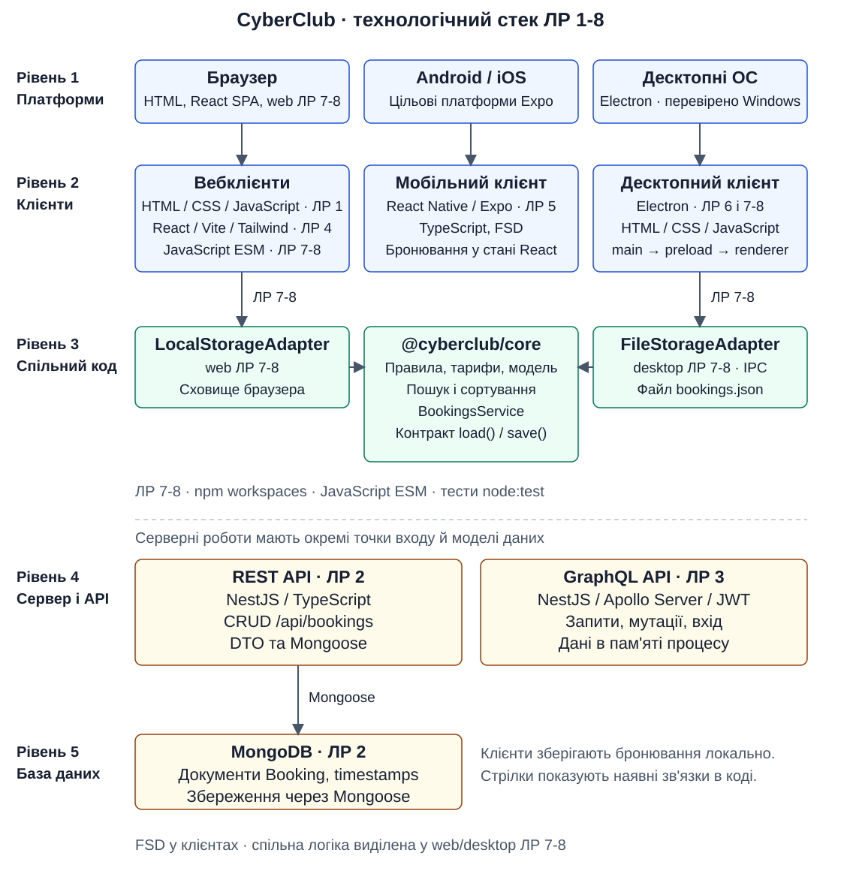

# CyberClub ЛР 7-8

Веб- та Electron-клієнт використовують спільний сервіс бронювання і різні сховища. Потрібні Node.js 24 та npm. Команди виконуються з цієї теки.

```sh
npm ci
npm test
npm run start:web
npm run start:desktop
```

Вебклієнт відкривається на http://localhost:3000. Для паралельного запуску використовуйте дві вкладки термінала.

- `packages/core` - модель і правила (`domain`), сервіс (`application`), контракт і тестове сховище (`ports`).
- `packages/web` - статичний HTTP-сервер, форма і список у FSD-шарах, адаптер `localStorage` з ключем `cyberclub-bookings`.
- `packages/desktop` - Electron main, IPC, preload, файловий адаптер і FSD-рендерер. У Windows дані зберігаються в `%APPDATA%\cyberclub-workspace-desktop\bookings.json`.

Для експерименту в `packages/core/domain/bookingValidation.js` змініть `MAX_DURATION_HOURS` з 12 на 4 і перезавантажте вебсторінку та Electron. Бронювання на 5 год має бути відхилене в обох клієнтах. Зміна `ERROR_EMPTY` має відобразитися в обох формах. Після експерименту поверніть початкові значення й запустіть `npm test`.
Обидва інтерфейси використовують нативний список зон і спільні правила ядра. Темну палітру взято з ЛР 1 і 6. У пошуку та повідомленнях використовуються українські підписи, дати показуються за київським часом.

## Технологічний стек і компетентності

Мій напрям - fullstack-розробка з акцентом на архітектуру кросплатформних застосунків. У CyberClub я реалізував клієнтські інтерфейси, два види API та спільну логіку бронювання. Для портфоліо найдетальніше показую ядро й адаптери ЛР 7-8.

### Стек технологій

| Рівень | Технології та лабораторні | Реалізація і вихідний код |
| --- | --- | --- |
| 1. Платформи | Браузер, Android/iOS, десктопні ОС. ЛР 1, 4-8 | [HTML-клієнт](../lab-1/), [React SPA](../lab-4/), [Expo](../lab-5/), [Electron](packages/desktop/). Браузер і Electron перевірені у Windows. |
| 2. Клієнти | HTML/CSS/JavaScript, React, TypeScript, Vite, Tailwind CSS, React Native/Expo, Electron. ЛР 1, 4-8 | [Форма і список web](packages/web/src/widgets/), [desktop renderer](packages/desktop/renderer/), [React-сторінка](../lab-4/src/pages/club-bookings/), [мобільний екран](../lab-5/src/pages/club-bookings/). |
| 3. Спільний код | JavaScript ESM, npm workspaces, dependency injection, адаптери, node:test. ЛР 7-8 | [Ядро](packages/core/), [LocalStorageAdapter](packages/web/src/shared/storage/localStorageAdapter.js), [FileStorageAdapter](packages/desktop/adapters/fileStorageAdapter.js), [тести ядра](packages/core/test/). |
| 4. Сервер і API | Node.js, NestJS, REST, GraphQL, Apollo Server, JWT. ЛР 2-3 | [REST CRUD](../lab-2/src/bookings/), [GraphQL resolver](../lab-3/src/bookings/bookings.resolver.ts), [реєстрація та вхід](../lab-3/src/auth/). У ЛР 7-8 [node:http](packages/web/server.js) роздає статичні файли. |
| 5. База даних | MongoDB і Mongoose. ЛР 2 | [Схема Booking](../lab-2/src/bookings/schemas/booking.schema.ts), [сервіс збереження](../lab-2/src/bookings/bookings.service.ts). GraphQL зберігає дані в масивах процесу, mobile - у стані React. |

Точні версії залежностей зафіксовані в lockfiles відповідних робіт. У цій монорепозиторній роботі використовую Electron 45.2.2 та власні пакети версії 1.0.0.

### Архітектура



Схема показує реалізовані зв'язки. Веб- та Electron-клієнти цієї роботи використовують `@cyberclub/core` і власні локальні сховища. React SPA й мобільна версія з попередніх робіт мають окрему логіку. REST API з MongoDB та GraphQL API є самостійними серверними реалізаціями.

### Що показую в коді

- **Одне правило для двох клієнтів.** [`BookingsService`](packages/core/application/bookingsService.js) перевіряє бронювання, обчислює ціну та виконує пошук. Коли я змінив `MAX_DURATION_HOURS` з 12 на 4, обидва клієнти відхилили сесію на 5 годин. Код клієнтів залишився тим самим. [Правило](packages/core/domain/bookingValidation.js) і [тести](packages/core/test/bookingValidation.test.js).
- **Збереження за контрактом.** Сервіс отримує адаптер з методами `load()` і `save()`. Веб використовує localStorage, Electron записує JSON через тимчасовий файл і перейменування. [Контракт](packages/core/ports/storage.js), [web](packages/web/src/shared/storage/localStorageAdapter.js), [desktop](packages/desktop/adapters/fileStorageAdapter.js).
- **Міст Electron.** Renderer викликає тільки `list`, `add`, `remove`. Головний процес перевіряє вікно й фрейм відправника, обробники перевіряють аргументи, ядро - правила бронювання. [Main](packages/desktop/main.js), [preload](packages/desktop/preload.cjs), [обробники](packages/desktop/ipcHandlers.js).
- **Два підходи до API.** У REST реалізував CRUD, DTO-валідацію й MongoDB. У GraphQL - запити, мутації та вхід із JWT. [REST controller](../lab-2/src/bookings/bookings.controller.ts), [GraphQL resolver](../lab-3/src/bookings/bookings.resolver.ts). Серверні роботи мають власні моделі даних.

### Історія проєкту

**Назва проєкту.** CyberClub - облік і бронювання ігрових місць кіберспортивного клубу.

**Проблема.** Адміністратору потрібно швидко додати бронювання, знайти гравця, вибрати зону й тривалість та побачити вартість сесії.

**Моя роль і внесок.** Я розробив веб-, мобільний і десктопний інтерфейси, REST та GraphQL API. У ЛР 7-8 виділив ядро, підключив два адаптери й написав тести.

**Чому обрав цей стек.** HTML і JavaScript дали змогу почати з браузера. React допоміг розділити інтерфейс на компоненти, TypeScript - описати дані. React Native з Expo дозволив перенести знайомий підхід до компонентів на телефон. Electron використав для desktop-вікна з доступом до файлів через IPC. NestJS дав модульну структуру для API. MongoDB підійшла для документів бронювання. JavaScript ESM і npm workspaces зв'язали клієнти зі спільним ядром без публікації пакета.

**Найскладніший кросплатформний виклик і рішення.** Правила бронювання повторювалися в окремих клієнтах, а способи збереження відрізнялися. Я виніс правила в `@cyberclub/core` і передав сховище через конструктор `BookingsService`. Тести запускаються зі сховищем у пам'яті, браузер і Electron підставляють власні адаптери.

**Здобуті знання та вміння.** Я вмію організувати клієнт за FSD, описати REST і GraphQL API, підключити Mongoose, розділити main/preload/renderer в Electron і перевірити платформонезалежну логіку тестами. Тепер розрізняю спільність коду та спільність даних. Наступним кроком для CyberClub обрав би підключення клієнтів до одного API та узгодження їхніх моделей бронювання.

### Перевірка і демонстрація

`npm test` запускає 31 тест у трьох пакетах. Ядро перевіряється зі сховищем у пам'яті, адаптери - окремо від UI. Для перевірки спільності правила змінюю `MAX_DURATION_HOURS` у ядрі, перезапускаю обидва клієнти й подаю однакове бронювання. Після експерименту повертаю початкове значення.

Для усної демонстрації показую додавання бронювання, пошук, збереження після перезапуску та зміну правила в одному файлі ядра.

## Репозиторій

[CyberClub на GitHub](https://github.com/subvincdebian/cross-platform-labs)
